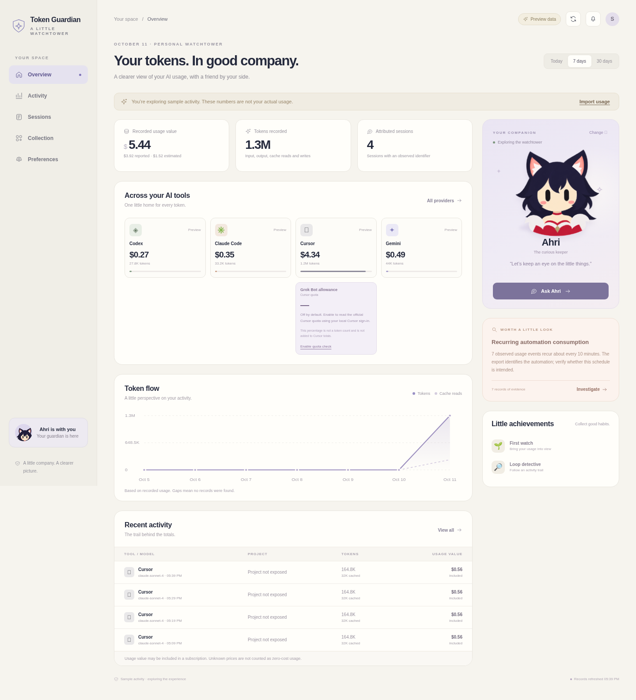

# Token Guardian

A local token tracker with a little company: investigate unexpected AI usage,
follow the available evidence, and ask a champion companion what happened.

This is the source prototype for
[JunyiZhou-Conny/token-guardian](https://github.com/JunyiZhou-Conny/token-guardian),
built on [xiufengsun/TokenTracker](https://github.com/xiufengsun/TokenTracker).
The first focus is **macOS**, with a Guardian view for records from **Codex,
Claude Code, Cursor, and Gemini CLI**. Codex covers the OpenAI coding-tool source;
this is not a complete OpenAI account or ChatGPT subscription usage monitor.



The screenshot uses labeled preview data. [Watch or download the 79-second demo](docs/demos/token-guardian-demo.mp4),
then use the [installation guide](docs/INSTALL.md) and [walkthrough](docs/DEMO.md)
to try the current prototype.

See the [session investigation view](docs/screenshots/guardian-sessions.png) and
[companion collection](docs/screenshots/guardian-collection.png) for more previews.

## Try the prototype

Install **Node.js 20 or newer**, then run from this repository:

```sh
node scripts/start-guardian.cjs
```

On macOS you can also double-click **Start Token Guardian.command**. The launcher
opens `http://127.0.0.1:7681` in your browser. Press Control-C in the terminal to
stop it. No npm install, account, or API key is needed for this Guardian launcher.

The standalone Guardian reads existing local TokenTracker records; it does not
install collection hooks or start a sync. If it finds no supported usage, it
shows clearly labeled **preview data**, including a simulated Cursor job repeating
every ten minutes. Choose **Show local records** to inspect your own dataset, or
import a Cursor usage CSV or normalized usage JSON. Reimporting an unchanged
export does not duplicate its records.

Existing records are read from `~/.tokentracker/tracker/`, with support for older
layouts. Imports stay in `~/.tokentracker/guardian/`. For a separate data folder or
port:

```sh
TOKENTRACKER_GUARDIAN_DATA_DIR=/path/to/data-root TOKENTRACKER_GUARDIAN_PORT=7682 node scripts/start-guardian.cjs
```

## What is here

- An overview and activity trail for the four target sources, with reported,
  estimated, and unknown usage values kept distinct.
- Investigation details with record links and available project, session,
  automation, and cloud-agent identifiers.
- A Sessions view that ranks available attributed sessions, explains the
  evidence basis, and suggests practical investigation steps. Missing session
  attribution remains visible instead of being guessed from totals.
- Detection of request spikes and recurring activity when individual events
  provide enough evidence. Cursor CSV parsing preserves populated Automation ID
  and Cloud Agent ID columns before aggregation.
- Ahri, Jinx, and Jhin prototype companions with classic and cozy outfits, a
  small sticker collection, and read-only companion chat. Preview achievements are illustrative; local
  achievements use your local records and actions.
- Optional OpenAI or DeepSeek explanations, and voice input that produces an
  editable question draft before you send it.
- An explicit, read-only Grok Bot in Cursor quota connection. It uses Cursor's
  existing sign-in to show the provider's percentage and reset time when exposed;
  these are quota measures rather than an additional token source.
- The upstream collector, React dashboard, and desktop app sources. See
  [Guardian setup and architecture](GUARDIAN.md) to collect usage and build on them.

## Evidence and privacy

An aggregate usage bucket cannot prove a ten-minute request schedule. Missing
identifiers remain unavailable, provider reports can arrive late, and a recurring
pattern is an investigation lead rather than proof of an unwanted job. Guardian
does not pause or kill the originating application. Refreshes and browser alerts
operate while its page is open.

Recorded usage value is not necessarily your subscription bill. Included plan
usage, estimated model cost, and extra on-demand charges are different measures.
Unknown pricing stays unknown.

Guardian collects usage metadata, not original prompts, code, or conversation
bodies. Without a key, chat uses a labeled local explanation engine. Optionally
configure `OPENAI_API_KEY` or `DEEPSEEK_API_KEY` in the server environment for
local-data questions. A paid explanation sends your question and a bounded
selection of usage metadata to the selected provider; local project paths,
session titles, and vendor session identifiers are excluded from that evidence.
Anything you type into the question itself is sent when you choose a model.
The browser starts with Local; select a configured provider to request a paid explanation.
OpenAI response storage is disabled. Preview questions stay local.
Defaults are **10 calls/day**, **350 output tokens/call**, and a **3,500 daily
output-token reservation limit**, shared across configured chat providers;
these do not guarantee a dollar spending cap. Voice has a separate privacy
choice: browser dictation may use the browser vendor's speech service, while
OpenAI transcription explicitly uploads your recorded audio. A transcript stays
in the question draft until you send it.
See [chat configuration](GUARDIAN.md#companion-chat) and the
[local service documentation](guardian-server/README.md) for details.

## Status and checks

This repository contains source, not a ready-to-install native release. There is
**no compiled or signed Guardian DMG yet**. Desktop and mobile Chromium checks
passed with preview data and synthetic imports. The four target collectors have not all been tested
end to end against real accounts on macOS. A friends pilot is the next step.

For the automated tests, use Node.js 22.20 or newer. The local checks ran on Node.js 24:

```sh
npm run guardian:test
```

The focused tests cover metadata normalization, imports, detection, local storage,
request handling, and mocked provider behavior. The local launcher and browser flows
were also checked: companion selection, evidence dialogs, chat citations, repeated
CSV imports, and mobile navigation. These checks do not replace a real macOS
collection and browser check. Detailed setup and limits are in [GUARDIAN.md](GUARDIAN.md);
the preserved upstream documentation is [README.upstream.md](README.upstream.md).
The demo uses isolated synthetic records, local explanations, and disclosed
mock browser dictation. Live model calls, real microphone recognition, and
Grok Bot quota access require an account-based check.

## Roadmap and feedback

1. **Friends pilot:** collect real Mac usage, reproduce a known scheduled run,
   and check whether a Cursor export exposes useful automation identifiers.
2. **Evidence coverage:** improve event detail and project/session links, publish
   what each source exposes, and make delayed or incomplete data visible.
3. **Collectible progress:** add persistent levels, stickers, and outfits earned
   by investigating activity and managing budgets.
4. **Reviewed improvements:** turn issues into reproductions, regression tests,
   AI-assisted pull requests, human review, and releases.

Use [issues](https://github.com/JunyiZhou-Conny/token-guardian/issues) for feedback.
Include the tool, OS, reproduction steps, and expected behavior. Share anonymized
usage metadata where useful; remove account identifiers, private paths, and keys.

## Source and artwork credits

The foundation is xiufengsun's MIT-licensed TokenTracker, pinned to commit
[`c388d675e2e7512264c44ede1610b7a28100307e`](https://github.com/xiufengsun/TokenTracker/tree/c388d675e2e7512264c44ede1610b7a28100307e).
The original copyright and license notice remain in [LICENSE](LICENSE). Import
provenance is recorded in [UPSTREAM_SNAPSHOT.json](UPSTREAM_SNAPSHOT.json), and
existing asset notices remain in [THIRD_PARTY_NOTICES.md](THIRD_PARTY_NOTICES.md).

The prototype champion atlas was generated from user-supplied Red Note references
credited to **AiBaker**. League of Legends characters belong to Riot Games. The
software MIT license does not license those characters or the reference artist's
work; see [avatar provenance](guardian/assets/PROVENANCE.md). This is an unofficial
fan prototype with no affiliation or endorsement from Riot Games or AiBaker.
