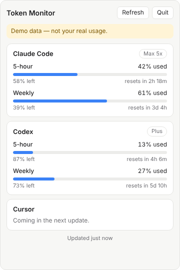

# Token Monitor

A small macOS menu-bar app that answers one question: **how much of my AI coding subscription is
left, and when does it reset?**

For each tool it shows the plan, how much of each usage window you've used, how much is left, and a
countdown to the reset:

| Tool | What it shows | Status |
| --- | --- | --- |
| Claude Code | 5-hour window, weekly window (and weekly Opus when reported) | Built, tested with synthetic data |
| Codex (ChatGPT plan) | 5-hour window, weekly window | Built, tested with synthetic data |
| Cursor | Included usage for the current period | Next milestone |
| Tokens and API-equivalent cost | Today and this week | Planned (via [ccusage](https://ccusage.com)) |



*The screenshot uses labeled demo data, not real usage.*

## Run it

You need macOS, [Node.js 22.12 or newer](https://nodejs.org/), and to be signed in to the tools you
want to see (run `claude` once, open Codex and sign in with ChatGPT).

```sh
git clone https://github.com/JunyiZhou-Conny/token-guardian.git
cd token-guardian
npm install
npm start
```

A gauge icon and a percentage appear in the menu bar. Click it to open the usage window; right-click
for **Refresh now** and **Quit**. The menu-bar number is your most-used window across all tools.

On macOS, Claude Code keeps its sign-in in the Keychain item "Claude Code-credentials", which Token
Monitor reads with the built-in `security` tool. macOS may ask whether to allow that; choose
**Always Allow** so later refreshes stay quiet. If access is denied, the Claude card says so instead of
showing numbers. *(Whether and how this prompt appears still needs a real-Mac check.)*

To look at the interface without any sign-in: `npm run demo`.

## How it works

Token Monitor reads the sign-in each tool already saved on your Mac and asks that tool's own usage
service for the numbers its app shows you:

- **Claude Code:** the OAuth token from `CLAUDE_CODE_OAUTH_TOKEN`, the macOS Keychain, or
  `~/.claude/.credentials.json`, sent to `api.anthropic.com/api/oauth/usage`.
- **Codex:** the ChatGPT sign-in in `~/.codex/auth.json`, sent to `chatgpt.com/backend-api/wham/usage`.
  Only if there is no `auth.json` (Codex can keep its sign-in in the system keyring instead) does it
  ask the local Codex CLI (`codex app-server`), which manages its own sign-in.

It refreshes every 5 minutes, and again shortly after a window resets. **Refresh** is limited to
once a minute.

These are the endpoints the tools' own apps use. **They are not documented public APIs** and can change
without notice; when one does, that card shows "Couldn't load usage" instead of a guess.

## Privacy

- Read-only: Token Monitor never rewrites or refreshes your sign-ins. If one has expired, it says so
  and you open the tool once to refresh it.
- Your tokens go only to each tool's own service (Anthropic, OpenAI). There is no server, telemetry, or
  analytics. Token Monitor keeps no usage history or credentials of its own; like any Electron app it
  has a standard folder in `~/Library/Application Support/Token Monitor` for browser settings and caches.
- The window gets only percentages, reset times, and plan names, never tokens or account IDs.

## Develop

```sh
npm test
```

Tests use synthetic responses and a fake Codex CLI, so they need no sign-in, network, or Electron
download. They run on any OS; the real endpoints, the Keychain prompt, and menu-bar placement can only
be checked on a Mac with real accounts.

| File | Purpose |
| --- | --- |
| `src/main.js` | Menu-bar icon and window |
| `src/refresher.js` | When to refresh: every 5 minutes, after resets, manual at most once a minute |
| `src/preload.js` | The page's only bridge: read status, refresh, quit |
| `src/ui/` | The usage window (plain HTML, CSS, JS) |
| `src/providers/claude.js`, `codex.js` | Read a sign-in, call one usage endpoint, map the answer |
| `src/limits.js` | The shared card shape and small helpers |
| `src/status.js` | Collects every provider; one failure never hides the others |
| `test/` | `node:test` suites and synthetic fixtures |

## Roadmap

1. ~~Menu-bar skeleton~~ and ~~Claude Code limits~~
2. ~~Codex limits~~
3. Cursor limits (read Cursor's local sign-in)
4. Tokens used and API-equivalent cost, today and this week
5. Double-click launcher, real-Mac checklist, polish

## Credits

The approach to reading each tool's limits is adapted from
[Javis603/token-monitor](https://github.com/Javis603/token-monitor) (MIT). See
[THIRD_PARTY_NOTICES.md](THIRD_PARTY_NOTICES.md). The earlier, larger Token Guardian prototype is kept
on the [`archive/guardian-v1`](https://github.com/JunyiZhou-Conny/token-guardian/tree/archive/guardian-v1) branch.

License: [MIT](LICENSE).
